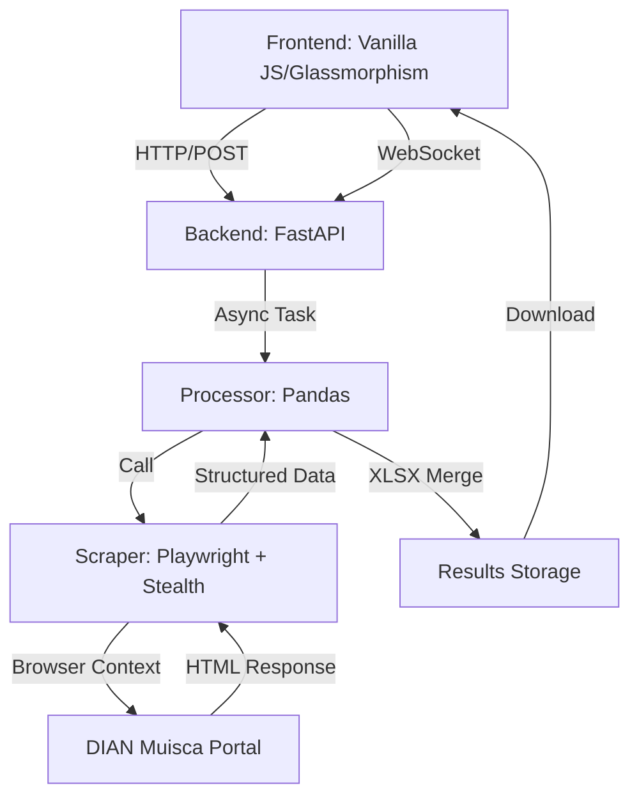

# DIAN RUT Automator - Documentación Técnica de Alta Precisión

Este aplicativo es un sistema de automatización robótica de procesos (RPA) diseñado para la consulta masiva y extracción de datos del Registro Único Tributario (RUT) desde el portal oficial de la DIAN (Colombia). Implementa técnicas avanzadas de evasión de detección de bots y procesamiento asíncrono.

## 🏗️ Arquitectura del Sistema

El sistema sigue una arquitectura de microservicios monolítica estructurada en capas de responsabilidad única:



### 📂 Estructura de Directorios

*   `main.py`: Punto de entrada de la API FastAPI. Gestiona rutas, estáticos y WebSockets.
*   `processor.py`: Motor de orquestación de datos. Maneja la lectura/escritura de Excel y la lógica de negocio.
*   `scraper.py`: Motor de automatización. Implementa Playwright para la navegación y extracción heurística.
*   `static/`: Activos del frontend (HTML, CSS, JS).
*   `uploads/`: Almacenamiento temporal de archivos recibidos.
*   `results/`: Almacenamiento de archivos procesados listos para descarga.
*   `browser_profile/`: Perfil persistente del navegador para mantener cookies y evadir huellas digitales.
*   `debug_html/`: Capturas de HTML para auditoría de errores.

---

## ⚙️ Especificaciones Técnicas

### 1. Capa de API (FastAPI)
- **Framework**: FastAPI (Asíncrono).
- **Comunicación en Tiempo Real**: WebSockets (`/ws/{client_id}`) para streaming de logs desde el backend al terminal del frontend.
- **Gestión de Archivos**: `uuid` para evitar colisiones de archivos en `uploads/` y `results/`.
- **Concurrencia**: Uso de `asyncio.create_task` para liberar el hilo de la API mientras el proceso de scraping ocurre en segundo plano.

### 2. Capa de Procesamiento (Pandas)
- **Estandarización de NIT**: Convierte automáticamente valores flotantes o científicos de Excel a cadenas limpias (`str(int(x))`).
- **Filtrado**: Elimina registros nulos o "nan".
- **Persistencia Progresiva**: Implementa un `save_callback` que realiza un `pd.merge(left, right, on='NIT')` tras cada consulta exitosa para evitar pérdida de datos ante fallos críticos.

### 3. Motor de Scraping (Playwright Deep Dive)
La lógica de `scraper.py` es la más compleja, diseñada para simular comportamiento humano:

#### Estrategias de Evasión (Stealth)
- **User-Agent Aleatorio**: Utiliza huellas digitales de navegadores modernos.
- **Stealth Plugin**: `playwright-stealth` para eliminar señales de automatización (e.g., `navigator.webdriver`).
- **Launch Arguments**: `--disable-blink-features=AutomationControlled`, `--no-sandbox`.
- **Perfil Persistente**: Uso de `launch_persistent_context` para manejar el almacenamiento local y caché de forma similar a un usuario real.

#### Lógica de Navegación JSF (JavaServer Faces)
El portal de la DIAN utiliza JSF, lo que implica IDs dinámicos y dependencias de estado de vista (`javax.faces.ViewState`).
1.  **Navegación Inicial**: Carga `DefConsultaEstadoRUT.faces`.
2.  **Manejo de Redirección**: Detecta si el portal redirige al inicio y fuerza la recarga de la página de consulta.
3.  **Humanización**:
    - `mouse.move()` aleatorios antes de interactuar.
    - `page.type()` con `delay=50ms` entre caracteres.
    - Pausas de estabilización de hasta 8 segundos para permitir que Cloudflare valide el desafío de red.
4.  **Extracción Heurística**:
    - Analiza el `innerText` completo del body.
    - Utiliza búsqueda por palabras clave (`ESTADO`, `RAZÓN SOCIAL`, `NOMBRES`) y navegación relativa por líneas para capturar valores aunque el DOM cambie.
    - Guarda el HTML en `debug_html/` para análisis post-mortem.

---

## 🔄 Flujo Lógico Paso a Paso

1.  **Carga**: El usuario sube un `.xlsx` con una columna llamada `NIT`.
2.  **Validación**: El servidor genera un `UUID` y valida la estructura del archivo.
3.  **Inicialización de Navegador**: Se lanza Chromium en modo *non-headless* (para mejor tasa de éxito) con configuración de sigilo.
4.  **Ciclo de Consulta**:
    - Se enfoca el selector `input[name*='numNit']`.
    - Se escribe el NIT lentamente.
    - Se dispara el evento de búsqueda (`btnBuscar`).
    - Se detecta si los resultados cargan en la misma pestaña o en una nueva (`target="_blank"`).
5.  **Extracción**: Se mapea el estado del RUT y el nombre/razón social.
6.  **Actualización**: Se hace un *merge* del resultado con los datos originales del Excel.
7.  **Finalización**: Se cierra el contexto del navegador y se habilita el botón de descarga.

---

## 🛠️ Instalación y Despliegue

### Requisitos locales
```bash
python3 -m venv venv
source venv/bin/activate
pip install -r requirements.txt
playwright install chromium
```

### Ejecución
```bash
uvicorn main:app --host 0.0.0.0 --port 8000
```

### Docker (Recomendado para aislamiento)
El `Dockerfile` incluye todas las dependencias compartidas necesarias para que Chromium corra en entornos Linux (Debian slim).
```bash
docker build -t dian-automator .
docker run -p 8000:8000 dian-automator
```

---

> [!IMPORTANT]
> **Nota para IAs**: Este aplicativo depende críticamente de la disponibilidad del portal DIAN Muisca. Las pausas (`asyncio.sleep`) son deliberadamente largas para mitigar el bloqueo por IP y permitir la resolución manual de CAPTCHAs si Cloudflare eleva el nivel de seguridad.
